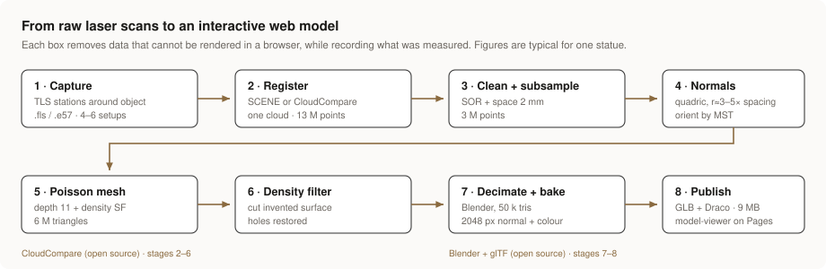

# TLS Scan Gallery — from laser scan to interactive web model

Terrestrial laser scans of heritage objects and building elements, processed into
web-ready 3D models that anyone can rotate in a browser or place at true size in AR.

**Live gallery:** https://&lt;user&gt;.github.io/&lt;repo&gt;/

---

## What this repository is

Two things:

1. **A working pipeline** — an open-source route from raw TLS data to a published,
   metrically correct 3D model, with the Blender automation and the viewer page included.
2. **A documented method** — [`docs/METHODOLOGY.md`](docs/METHODOLOGY.md) explains every
   stage and every parameter: what it does, why it is needed, how to choose the value
   from your own data, and how to check the result before moving on.



The pipeline is deliberately reproducible without proprietary software. FARO SCENE is
used for registration where available, but CloudCompare can do the same job, and nothing
after that stage requires a licence.

## Why it matters

A raw scan is a measurement record, not a deliverable — it is gigabytes, needs specialist
software, and almost nobody who should see it can open it. This pipeline produces a 5–15 MB
file that loads in any browser while keeping the three properties that make it documentation
rather than decoration:

- **Metric correctness** — real-world units preserved end to end, so the model can be measured.
- **Honest geometry** — surfaces the scanner never saw are deleted, not silently invented.
  (Poisson reconstruction always closes the surface; the density field tells you where it guessed.)
- **Traceability** — every parameter recorded, so the work can be repeated.

## Layout

```
.
├── index.html              viewer page — edit the MODELS list, nothing else
├── models/                 published .glb files
├── scripts/
│   └── scan_to_glb.py      Blender: decimate, UV, bake normal + colour, export GLB
└── docs/
    ├── METHODOLOGY.md      the full explanation — start here
    └── figs/               diagrams (SVG)
```

## Quick start

**Process a mesh into a web model**

```bash
blender -b -P scripts/scan_to_glb.py -- \
  --input  statue_highpoly.ply \
  --output models/statue.glb \
  --faces  50000 \
  --texsize 2048
```

Batch a folder:

```bash
for f in meshes/*.ply; do
  blender -b -P scripts/scan_to_glb.py -- \
    --input "$f" --output "models/$(basename "${f%.ply}").glb"
done
```

**Publish**

Add the `.glb` to `models/`, add an entry to the `MODELS` list in `index.html`, commit, and
enable **Settings → Pages → Deploy from a branch → main / (root)**.

> Do not put `.glb` files in Git LFS — GitHub Pages does not serve LFS objects and the
> viewer will fail. Keep them as ordinary git objects, under 25 MB each.

## The short version of the method

| Stage | Tool | Key parameter | Chosen from |
|---|---|---|---|
| 1 Capture | TLS | 4–6 stations, overlap | object geometry |
| 2 Register | SCENE *or* CloudCompare ICP | record the RMS | — |
| 3 Clean + subsample | CloudCompare | space ≈ point spacing | measured spacing |
| 4 Normals | CloudCompare | **quadric**, radius 3–5 × spacing, MST knn 10 | measured spacing |
| 5 Mesh | CloudCompare Poisson | depth where bbox/2ᵈ ≈ spacing | bbox + spacing |
| 6 Density filter | CloudCompare | cut the low-density tail | histogram |
| 7 Decimate + bake | Blender | 50 k triangles, 2048 px maps | target file size |
| 8 Publish | glTF + model-viewer | Draco on | — |

Full reasoning, failure modes and inspection steps: [`docs/METHODOLOGY.md`](docs/METHODOLOGY.md).

## Requirements

- [CloudCompare](https://www.cloudcompare.org/) (GPL)
- [Blender](https://www.blender.org/) 4.x (GPL) — ships with Python and Cycles, no add-ons needed
- A browser. No build step, no npm, no server.

## Provenance and rights

Each model carries a provenance record (instrument, stations, registration error, point
spacing, every processing parameter, archive location) — see section 12 of the methodology
for the template. Scanning creates no rights in the object scanned: for modern works, check
the rights position in the object itself before publishing.
