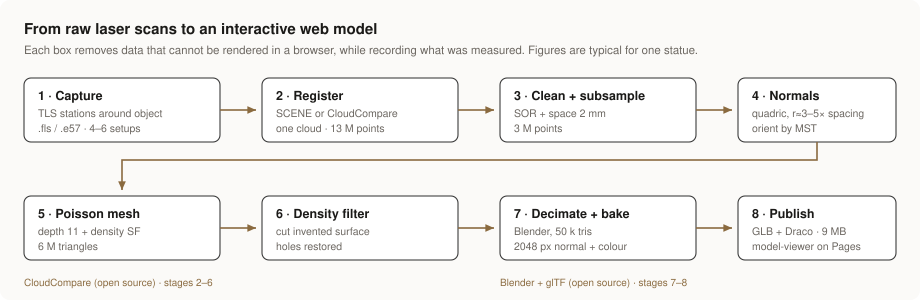
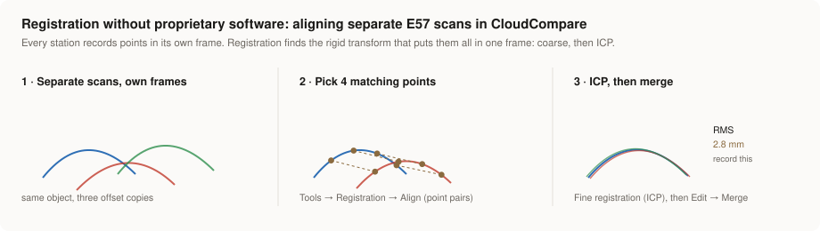
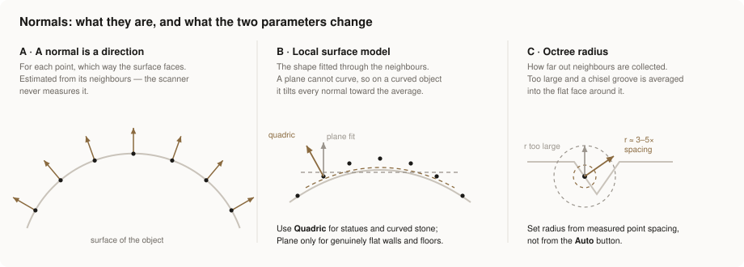
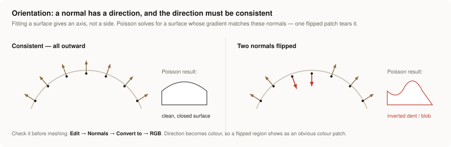
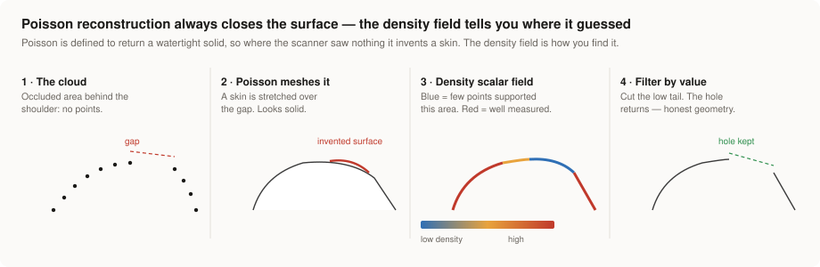
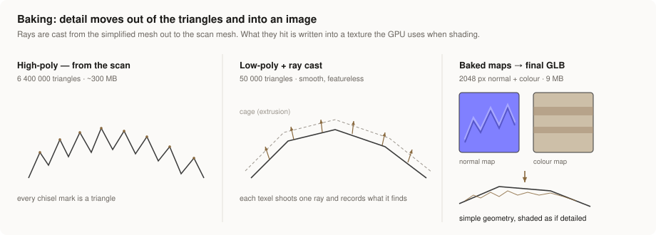

# From TLS point cloud to an interactive web model

**A working methodology, with every parameter explained**

This document explains the complete chain from raw terrestrial laser scanner (TLS) data to a 3D model that anyone can rotate in a browser. It is written to be followed by someone who has never done it, and to be defensible as a documented method — each step states *what* it does, *why* it is needed, *how to choose the parameter values*, and *how to check the result before moving on*.

The pipeline is reproducible with open-source software. Proprietary tools (FARO SCENE, Autodesk, Leica Cyclone) can replace the first stage, but nothing after stage 2 requires them.



---

## Contents

1. [Why this pipeline exists](#1-why-this-pipeline-exists)
2. [Vocabulary](#2-vocabulary)
3. [Stage 1–2 · Capture and registration](#3-stage-12--capture-and-registration)
4. [Stage 3 · Cleaning and subsampling](#4-stage-3--cleaning-and-subsampling)
5. [Stage 4 · Normals](#5-stage-4--normals)
6. [Stage 5–6 · Poisson reconstruction and density filtering](#6-stage-56--poisson-reconstruction-and-density-filtering)
7. [Stage 7 · Decimation and texture baking](#7-stage-7--decimation-and-texture-baking)
8. [Stage 8 · glTF, the viewer and hosting](#8-stage-8--gltf-the-viewer-and-hosting)
9. [Parameter quick reference](#9-parameter-quick-reference)
10. [How to see these numbers in CloudCompare](#10-how-to-see-these-numbers-in-cloudcompare)
11. [Troubleshooting](#11-troubleshooting)
12. [What to record for each model](#12-what-to-record-for-each-model)
13. [Software and references](#13-software-and-references)

---

## 1 · Why this pipeline exists

A TLS survey of a single object produces something on the order of 10–50 million points, 2–10 GB on disk, readable only in specialist software. That is a measurement record, not a deliverable. Three groups of people cannot use it:

- **Reviewers, supervisors, clients, the public** — no software, no training.
- **Web and mobile** — a browser cannot render tens of millions of points, and a phone has a few hundred megabytes of GPU memory.
- **Downstream modellers** — they need surfaces, not points.

The pipeline converts the measurement record into a *web-deliverable* while keeping three properties that make it documentation rather than decoration:

1. **Metric correctness.** The final model is in real-world units. A viewer can measure it; in AR it appears at true size.
2. **Honest geometry.** Surfaces that were never measured are deleted rather than silently invented (stage 6). This is the step most published scan models skip.
3. **Traceability.** Every parameter is recorded (section 12), so another person can repeat the work and get the same model.

The output is a glTF binary (`.glb`) of roughly 5–15 MB that loads in any browser, served as a static file from GitHub Pages at no cost.

---

## 2 · Vocabulary

Terms used throughout, in the order you meet them.

| Term | Meaning |
|---|---|
| **TLS** | Terrestrial laser scanning. A tripod-mounted scanner measures range and angle to millions of surface points from a fixed position (a *station* or *setup*). |
| **Point cloud** | The set of measured points, each with X, Y, Z and usually RGB (from the scanner's camera) and intensity (strength of the laser return). |
| **Station / setup** | One scanner position. An object needs several because the scanner only sees what is in direct line of sight. |
| **Registration** | Finding the rigid transform (rotation + translation) that brings all stations into one shared coordinate frame. |
| **Occlusion** | A surface that no station could see — behind a shoulder, under a fold. It produces a hole in the cloud, and holes are the central problem of stage 6. |
| **Point spacing** | The typical distance between neighbouring points on the surface, in metres. The single most important number in the whole pipeline: almost every later parameter is a multiple of it. |
| **Scalar field (SF)** | A number attached to every point or vertex, separate from its position — intensity, density, distance, roughness. CloudCompare can colour by it, histogram it and filter on it. |
| **Normal** | A unit vector at a point giving the direction the surface faces there. Not measured by the scanner — it is *estimated* from the neighbouring points (stage 4). |
| **Mesh** | A surface built from triangles. Unlike a point cloud it is continuous, so it can be shaded, textured and rendered. |
| **Vertex** | A corner of a triangle. A mesh from Poisson reconstruction carries colour per vertex. |
| **Triangle count** | The cost measure for rendering. Browsers are comfortable up to a few hundred thousand triangles per scene. |
| **Decimation** | Reducing triangle count by collapsing edges, keeping the overall shape. |
| **UV map** | A 2D coordinate assigned to every vertex, saying where that part of the surface lands on a flat image. Required before any texture can be applied. |
| **Texel** | One pixel of a texture, as seen on the surface. |
| **Normal map** | An image in which each pixel encodes a direction (XYZ packed into RGB) rather than a colour. Lets a simple mesh be shaded as if it had fine detail. |
| **Baking** | Transferring information (shape, colour) from a detailed mesh onto the texture of a simplified one, by ray casting. |
| **glTF / GLB** | The standard transmission format for 3D on the web (sometimes called "the JPEG of 3D"). `.gltf` is JSON plus separate files; `.glb` packs everything into one binary file. |
| **Draco** | A geometry compression codec supported by glTF. Typically 5–10× smaller, decompressed in the browser. |
| **LOD** | Level of detail — the idea of delivering a model at the resolution the viewing situation needs, not the maximum available. |

---

## 3 · Stage 1–2 · Capture and registration

### What it does

Turns several separate scans, each in its own coordinate frame with the scanner at the origin, into one coherent cloud of the object.

### Why it is needed

A single station cannot see a three-dimensional object. For a free-standing statue, plan four to six stations distributed around it, with generous overlap. Registration is what makes them one object rather than several ghosts.

### Path A — FARO SCENE (if you have it)

1. **New project → import** the raw `.fls` scans.
2. **Process Scans.** Enable *Colorize Scans* if photographs were captured — this is what puts RGB on the points, and without it the final model is grey. Enable *Find Targets* only if spheres or chequerboards were used.
3. **Filters**, applied during processing:
   - *Dark Scan Point Filter* — discards returns too weak to trust.
   - *Distance Filter* — discards points outside a range you set.
   - *Stray Point Filter* — discards isolated points. This one matters most for an object: where the beam clips a silhouette edge it straddles the surface and the gap behind it, returning a *mixed pixel* that lies in empty space. Those points become spikes in the Poisson mesh. Removing them here saves hours later.
4. **Register** — cloud-to-cloud (top-view based) or target-based. Open the **registration report** and record the mean point error. That number is your stated accuracy; write it down now (section 12).
5. **Clip box** tightly around the object. Export only what you need.
6. **Create Project Point Cloud**, then **Export → E57**.

> **Why E57 and not the native format:** E57 (ASTM E2807) is an open, documented standard that stores points, colour, intensity and per-station structure. Exporting to it is what makes everything downstream software-independent, and what lets someone without SCENE reproduce your work.

**Export tip:** if you export as a single unified cloud, the per-station sensor origins are discarded. Those origins are useful later (they make normal orientation exact and instant — see stage 4). To keep them, export with scans as **separate scan nodes** rather than one merged cloud.

### Path B — No proprietary software, separate E57 files



CloudCompare can register scans itself. It is slower and less automated than SCENE, but free and perfectly adequate for a single object.

1. **File → Open** each `.e57`. Accept the global shift when prompted (see section 10).
2. Pick one scan as the reference. Select it and a second scan.
3. **Tools → Registration → Align (point pairs picking).** Click four or more clearly identifiable features — a nose tip, a corner of the plinth, a crack junction — in the same order on both clouds. CloudCompare reports an RMS error and applies a coarse transform.
   *Why four:* three points define a rigid transform exactly; the fourth and beyond give redundancy, so the RMS is a meaningful check rather than zero by construction.
4. **Tools → Registration → Fine registration (ICP).** ICP (Iterative Closest Point) repeatedly pairs each point with the nearest point on the other cloud and solves for the transform that minimises the total squared distance, until it converges.
   - *Final overlap*: the percentage of the moving cloud that genuinely appears in the reference. For scans around an object this is often 40–70 %, not 100 %. Setting it too high forces ICP to match points that have no counterpart and drags the alignment off.
   - *Random sampling limit*: 50 000 is plenty; more is slower with no benefit.
   - Record the **final RMS**. This is your registration accuracy.
5. Repeat for each remaining scan against the reference.
6. Select all aligned clouds → **Edit → Merge**.

**Sanity check before continuing:** set the display to a cross-section (the clipping box tool) and look at a wall or the plinth edge. Well-registered scans show one thin surface. Badly registered scans show two or three parallel surfaces a few millimetres apart — this is *doubling*, and it is fatal: Poisson will either average it into a blurred surface or produce two skins.

---

## 4 · Stage 3 · Cleaning and subsampling

### 4.1 Segmenting

**Edit → Segment** (scissors icon, or `T`). Draw a polygon around what you want and press the tick to keep the inside or the cross to remove it.

*Why:* ground, vegetation, passing people and the wall behind the statue all contribute points that Poisson will try to mesh into the object. Removing them is faster than cleaning the mesh afterwards.

Keep a small margin of plinth — it gives the object a base to stand on, and a flat reference surface is useful for checking scale later.

### 4.2 Noise removal — SOR filter

**Tools → Clean → SOR filter** (Statistical Outlier Removal).

For every point, it measures the mean distance to its *k* nearest neighbours. It then computes the mean and standard deviation of that quantity across the whole cloud, and deletes any point whose mean neighbour distance exceeds `mean + n_sigma × std`.

| Parameter | Typical | What it does |
|---|---|---|
| Number of neighbours (k) | 6 | How many neighbours define "local". Smaller is more aggressive and more sensitive to real detail; 6–10 is standard. |
| Standard deviation multiplier (n_sigma) | 1.0 | How far from typical a point must be before it is deleted. Lower = more aggressive. |

*Why it is needed:* the mixed pixels described in stage 1 sit in empty space, so their neighbours are far away — exactly what this test detects. Run it once; check the console for how many points were removed. If it removed more than ~2 % you are probably cutting into real surface: raise n_sigma to 1.5 and re-run on the original.

*Where it fails:* SOR cannot remove a *cluster* of noise (a bush, a railing) because those points have close neighbours. Use segmentation for those.

### 4.3 Subsampling

**Edit → Subsample → Space**, with a minimum distance between points.

This keeps points no closer together than the distance you set, discarding the rest.

*Why it is needed — three separate reasons:*

1. **Redundancy.** Scans overlap. Where three stations saw the same surface you have three times the points but no more information. The surface is not three times better measured; it is just three times heavier.
2. **Uniformity.** TLS point density falls off with distance and with grazing incidence. Poisson reconstruction assumes a reasonably uniform sampling; a cloud that is dense near the scanner and sparse at the back produces a mesh that is over-detailed in one place and lumpy in another.
3. **Tractability.** The normal estimation and orientation steps in stage 4 are superlinear in point count. Halving the points more than halves the runtime.

**Choosing the value:** set it at or slightly below the true point spacing of the data. There is no benefit in going finer than what the scanner actually resolved, and no justification for claiming detail you did not measure.

For a statue scanned at typical settings from 3–5 m, 0.002 m (2 mm) is a sound default. The example cloud in this repository went from 13.37 M points to roughly 3 M at 2 mm, with no visible loss.

> **How to find your real point spacing** — three methods, in order of effort:
> 1. **The subsample trick.** Run *Subsample → Space* with a small value, e.g. 0.0005 m. If the output point count is nearly the same as the input, your real spacing is larger than 0.5 mm. Double the value and repeat until the count starts to drop sharply. The value where it begins to drop is your spacing.
> 2. **Compute geometric features.** *Tools → Other → Compute geometric features*, tick **Surface density**, set a radius of about 0.01 m. This gives points per m². Spacing ≈ 1 / √density.
> 3. **Point picking.** Zoom in hard until individual points separate, then use the point-picking tool on two adjacent points and read the distance. Crude, but it builds intuition about what the numbers mean.

---

## 5 · Stage 4 · Normals

This is the stage that most often ruins a scan-to-mesh job, and the one people understand least. It deserves the most space.



### 5.1 What a normal is and why the cloud has none

A laser scanner measures *positions*. It has no idea which way a surface faces — it does not know there *is* a surface, only that something reflected a pulse at a certain range and angle.

A normal is the unit vector pointing away from the material at a point. It must be *estimated*, by looking at the point's neighbours and asking: if these points lie on a surface, what is the orientation of that surface here?

### 5.2 Why normals are required

Poisson surface reconstruction (stage 5) does not fit a surface to the *points*. It treats the oriented normals as samples of the gradient of an indicator function — a function that is one inside the object and zero outside — and solves a Poisson equation for that function. The surface is then extracted as a level set.

In practical terms: **the normals are the input that tells the algorithm where "inside" is.** A point cloud with no normals or wrong normals does not produce a slightly worse mesh; it produces a meaningless one.

### 5.3 The dialog — `Edit → Normals → Compute`

> **Note on the menu:** in current CloudCompare versions, computing and orienting normals are a single dialog. The *Orientation* group inside **Compute normals** is the orient step — there is no separate command to find. A standalone `Edit → Normals → Orient normals` entry exists in some builds but is only enabled once normals already exist, for re-running orientation without recomputing.

#### Local surface model

The shape fitted through the neighbourhood before the normal is read off it.

| Option | Use for | Why |
|---|---|---|
| **Plane** | Walls, floors, flat slabs, road surfaces | Fastest. Correct when the surface genuinely is locally flat. |
| **Quadric** | **Statues, columns, ornament, any curved stone** | Fits a curved patch (a second-order surface). On a curved object a plane fit cannot represent the curvature, so it returns a normal biased toward the average facing direction of the neighbourhood. Every point in a convex or concave area is then slightly wrong in a *systematic* direction, and Poisson rounds the feature off. |
| **Triangulation** | Clouds with abrupt steps, sharp machined edges | Uses a local Delaunay triangulation. Preserves creases better; more sensitive to noise. |

For heritage objects, use **Quadric**. The extra computation is a few minutes; the difference in preserved detail is visible.

#### Octree radius

The radius of the sphere inside which neighbours are collected.

This is the parameter with the most impact and the worst default. CloudCompare's **Auto** button derives a value from the octree subdivision level, which is driven by the bounding box, not by your point spacing. On a 3.4 m object it typically suggests something around 0.035 m — a 35 mm sphere. If your point spacing is 2 mm, that sphere contains hundreds of points spanning a patch the size of a fist. Every chisel mark, fold and edge inside that patch is averaged into a single orientation.

**Rule: radius ≈ 3 to 5 × point spacing.**

| Point spacing | Radius to use |
|---|---|
| 1 mm | 0.003 – 0.005 m |
| 2 mm | 0.006 – 0.010 m |
| 5 mm | 0.015 – 0.025 m |

Too small and you are fitting a surface through three or four points, so noise dominates and the normal field looks speckled. Too large and detail is smoothed away before meshing even starts. If in doubt, start at 4× and compare: compute normals at two radii into two copies of the cloud and look at both.

#### Orientation

Fitting a surface gives an *axis*, not a *side*: the mathematics is equally satisfied by a vector and its opposite. Something external must decide which end points away from the material, consistently, across the whole cloud.



| Option | When available | How it works |
|---|---|---|
| **Use sensor(s)** | Only if the cloud still carries per-station sensor positions | Exact and instant: the surface must face the scanner that saw it, so flip any normal pointing away from the sensor origin. This is the best option when you have it. Greyed out after exporting a merged cloud from SCENE — re-export with separate scan nodes to get it back. |
| **Use scan grid(s)** | Only for structured (gridded) scans | Uses the scanner's row/column structure, which implies the viewing direction. |
| **Use preferred orientation** (+X, −Z, …) | Always | Flips all normals to the hemisphere facing a chosen axis. Correct only for an open surface facing roughly one way — a façade, a floor, a terrain patch. **Wrong for a closed object**, where normals must point outward in all directions. |
| **Use Minimum Spanning Tree** | Always | The general-purpose method. Builds a graph connecting each point to its *k* nearest neighbours, weighted so that neighbouring points with similar orientations are cheap to connect, then propagates a consistent orientation outward along the minimum spanning tree of that graph. |

For a free-standing statue with no sensor information, **Minimum Spanning Tree** is the right choice.

**knn value:** the default of 6 is thin. On noisy silhouette edges a six-neighbour graph can take a wrong branch, and once orientation propagates through a wrong edge the whole downstream region is flipped. Use **10**. The cost is runtime; the benefit is robustness.

MST on 13 million points is slow and memory-hungry — another reason to subsample first (section 4.3).

### 5.4 How to check the result before meshing

Do not skip this. It takes thirty seconds and saves an hour of confused re-meshing.

**Edit → Normals → Convert to → RGB.** Each normal direction is mapped to a colour, so the cloud is painted by orientation. A correctly oriented closed object shows smooth colour gradients that change gradually as the surface turns. A flipped region shows as an abrupt patch of a contrasting colour with a hard boundary that follows no feature of the object.

Afterwards, reload or re-run if you want the original RGB back — this operation overwrites the colour channel, so work on a copy, or simply recompute colours by reloading the file.

Alternatively, enable normal display in the **Properties** panel and zoom in; the normal vectors are drawn as short lines.

---

## 6 · Stage 5–6 · Poisson reconstruction and density filtering



### 6.1 Running it

**Plugins → PoissonRecon** (the Screened Poisson Surface Reconstruction plugin, Kazhdan & Hoppe).

| Parameter | Typical | What it controls |
|---|---|---|
| **Octree depth** | 10–12 | The resolution of the solver grid. The grid is 2^depth cells across the bounding box, so depth 10 ≈ 1024 cells, depth 12 ≈ 4096. Each step up multiplies memory and time by roughly 8. |
| **Samples per node** | 1.0–1.5 | How many points the solver expects per grid cell. Raise it for noisy data — it smooths. Leave at 1 for clean data. |
| **Interpolate colours** | on | Carries the scanner RGB from points to mesh vertices. Essential: this is what the colour bake in stage 7 reads. |
| **Output density as SF** | **on** | Writes a per-vertex scalar field recording how much point support each part of the surface had. Without this, section 6.2 is impossible. |

**Choosing depth from your data, not by guessing:** the cell size at depth *d* is (bounding box size) / 2^d. You want that close to your point spacing. For a 3.4 m object at 2 mm spacing: 3.4 / 2^11 = 1.7 mm. Depth 11 is right. Depth 13 would ask for 0.4 mm cells that the data cannot fill, producing noise and an enormous file.

### 6.2 Why the result looks wrong, and the density filter

Poisson reconstruction is *defined* to return a watertight (closed) surface. That is a feature — it is what makes the result a solid rather than a set of patches — but it has a consequence that must be handled explicitly:

**Where the scanner saw nothing, the algorithm invents a surface anyway.** Occluded areas behind the shoulder, under the arm, the unscanned underside — all get a smooth skin stretched across them. The result often has a balloon-like blob extending beyond the object. Nothing about the mesh itself distinguishes measured surface from invented surface.

The density scalar field does distinguish them. It records, per vertex, how much point evidence supported that part of the solution. Invented regions have near-zero density.

**To cut them:**

1. Select the mesh. In **Properties**, set the active scalar field to the density field.
2. Open the histogram (toolbar histogram icon). You will see a large population at higher density values and a long tail at low values — that tail is the invented surface.
3. **Edit → Scalar fields → Filter by value.** Set the minimum at the point where the main population begins, leave the maximum at the top, and apply. CloudCompare creates a new mesh containing only vertices above the threshold.
4. Inspect. The holes have reappeared. If genuine surface was cut, lower the threshold slightly and repeat.

**Why this matters beyond aesthetics.** A heritage or as-built record that silently contains invented geometry is not a record — a user cannot tell which parts are measurement and which are interpolation. Deleting the unsupported surface converts the deliverable from "a nice-looking model" to "a statement of what was observed". The holes are information: they document occlusion, and they tell the next surveyor where to put a station. This is the step that makes the whole exercise defensible, and it takes two minutes.

If you need a closed model for 3D printing or volume calculation, fill the holes *afterwards*, as an explicit, separately documented operation (MeshLab's *Close holes*, or Blender), so the two stages stay distinguishable.

### 6.3 Export

**File → Save as → PLY (binary)**, with colours.

PLY is chosen because it carries per-vertex colour simply and is read by everything. Binary rather than ASCII: roughly 3× smaller and much faster to load.

**Switch off global shift on export** if prompted (see section 10), so the mesh arrives in Blender with small local coordinates.

---

## 7 · Stage 7 · Decimation and texture baking

Run by `scripts/scan_to_glb.py` in this repository; this section explains what the script is doing and why.



### 7.1 The problem

The mesh from stage 6 has a few million triangles and per-vertex colour. Two things make it unusable on the web:

- **Size.** Several hundred megabytes.
- **Colour storage.** Per-vertex colour means colour resolution is tied to triangle density. Decimate the mesh and the colour degrades with it.

### 7.2 The solution: keep two meshes, transfer between them

| Mesh | Triangles | Role |
|---|---|---|
| **High-poly** | 2–10 M | The scan mesh. Holds all real geometric detail and the scanner's RGB. Used only as a *source*, then discarded. |
| **Low-poly** | 30 000–80 000 | A decimated copy. Cheap to render, but smooth and featureless on its own. The mesh that ships. |

**Decimation** (Blender's Decimate modifier, *Collapse* mode) repeatedly removes the edge whose removal changes the shape least, until the target triangle count is reached. The silhouette and overall form survive; fine surface relief does not.

**UV unwrapping** (*Smart UV Project*) automatically cuts the low-poly into flat islands and arranges them on a square image. Without UVs there is nowhere for a texture to live.
- *Angle limit* (66°) — how sharply the surface must turn before a new island is started. Lower = more, flatter islands with less distortion but more seams.
- *Island margin* — padding between islands, so that filtered texture lookups at small sizes do not bleed one island's colour into its neighbour.

**Baking** transfers information from high-poly to low-poly. Blender's *selected to active* mode casts a ray outward from each texel of the low-poly surface, finds where it strikes the high-poly, and records what it finds there:

- **Normal bake** → a normal map. Each pixel stores the *direction the real surface faces* at that point, packed as RGB. During rendering the shader replaces the low-poly's own smooth normal with this one, so light behaves as if the detail were present. The detail is gone from the geometry and preserved in an image — which is far cheaper, because an image is a compressed 2D array and triangles are not.
- **Diffuse bake** (colour pass only, lighting excluded) → a colour map carrying the scanner RGB into a texture. Excluding lighting matters: a model with shadows baked into its colours looks wrong when the viewer lights it from elsewhere.

**Cage extrusion** is how far outside the low-poly the rays start. Too small and rays in concave areas start inside the high-poly and miss, producing black artefacts in crevices. Too large and a ray cast from one part of the surface can strike an unrelated nearby part, producing smeared detail. The script sets it to 1 % of the bounding-box diagonal, which is a good starting point; increase it if deep folds come out black.

**Texture size** is the resolution of the baked images. 2048 px is a sound default: it gives roughly 1 mm of texture resolution on a 2 m object, which matches typical TLS detail. 4096 doubles file size for detail the scan does not contain. 1024 is appropriate for small or distant objects.

### 7.3 Why the result is legitimate and not a trick

Baking is the standard publication route for heritage 3D — it is how models reach Sketchfab, Europeana and museum portals. The important properties are preserved:

- The *shape* is the measured shape, at the accuracy a 50 000-triangle surface can hold (for a 2 m statue, better than 2 mm — well inside TLS accuracy).
- The *scale* is untouched. The script centres the object on the origin but never rescales it, so measurements in a viewer are real.
- The *surface relief* is recorded in the normal map rather than discarded.

What is *not* preserved is the ability to take arbitrary high-precision measurements off the fine relief. That is what the archived high-poly mesh and the original point cloud are for. The GLB is a dissemination product; the cloud is the archival record. Say this explicitly in your repository and the deliverable is unambiguous.

---

## 8 · Stage 8 · glTF, the viewer and hosting

### 8.1 Why glTF / GLB

glTF 2.0 is the Khronos standard for runtime 3D delivery — designed for transmission and immediate display, not for editing. It stores geometry, UVs, textures and material definitions in a single binary (`.glb`) with no external dependencies, and every browser engine and AR framework reads it natively.

**Draco compression** is enabled in the export. It quantises and entropy-codes vertex positions and attributes, typically 5–10× smaller, decoded in the browser. The decoder is a few hundred kilobytes and is fetched automatically.

**Textures as JPEG** rather than PNG: textures dominate file size once geometry is Draco-compressed, and photographic scan colour compresses well. Quality 85 is visually lossless at this scale.

### 8.2 The viewer

`index.html` uses `<model-viewer>`, a web component from Google that wraps three.js and handles orbit controls, lighting, progressive loading and AR behind a single HTML tag. No build step, no npm, no server — which is exactly what a static host can serve.

Attributes worth understanding:

| Attribute | Effect |
|---|---|
| `camera-controls` | Enables drag to orbit, scroll to zoom. |
| `environment-image="neutral"` | Lights the model with a built-in neutral studio environment. Scan colour already contains the lighting at capture time, so a neutral environment avoids double-lighting. |
| `shadow-intensity` | A contact shadow under the object. Helps the eye read depth; purely presentational. |
| `ar` / `ar-modes` | Offers AR on supported phones. Because the GLB is in real units, the object appears at true size. |
| `loading="lazy"` | Defers download until the viewer scrolls near it — important with several models on one page. |
| `poster` | A still image shown while the model loads. |

Pin the `<model-viewer>` version in the script tag rather than floating to latest: it tracks three.js closely and upstream changes can break a page you are not watching.

### 8.3 Hosting on GitHub Pages

```bash
git init
mkdir -p models docs/figs scripts
# place index.html at the repo root, GLBs in models/
git add .
git commit -m "TLS statue, web-ready glTF"
git branch -M main
git remote add origin https://github.com/<user>/<repo>.git
git push -u origin main
```

Then **Settings → Pages → Source: Deploy from a branch → main / (root)**.

Two traps worth knowing in advance:

- **Do not put the GLB in Git LFS.** GitHub Pages does not serve LFS objects — the browser receives a text pointer file and the viewer fails with an unhelpful error. Keep models as ordinary git objects.
- **Get the size right before the first commit.** Git keeps every version of a binary forever; committing a 300 MB mesh and deleting it later does not shrink the repository. Hard limit is 100 MB per file; aim for under 25 MB for a usable mobile experience.

---

## 9 · Parameter quick reference

| Stage | Parameter | Default to use | Derived from | Symptom if wrong |
|---|---|---|---|---|
| Clean | SOR neighbours | 6 | — | Too low: real detail removed |
| Clean | SOR σ multiplier | 1.0 | — | Too low: surface eaten; too high: spikes remain |
| Subsample | Space | ≈ point spacing (2 mm typical) | Measured spacing | Too fine: slow, no gain; too coarse: lost detail |
| Normals | Local surface model | **Quadric** | Object curvature | Plane on curved object: rounded-off features |
| Normals | Octree radius | 3–5 × spacing | Measured spacing | Too large: smoothed detail; too small: speckled noise |
| Normals | Orientation | Sensor if available, else MST | Available metadata | Preferred-axis on closed object: inverted regions |
| Normals | MST knn | 10 | — | Too low: flipped patches |
| Poisson | Octree depth | 11 | bbox / 2^d ≈ spacing | Too high: noise + huge file; too low: blobby |
| Poisson | Samples per node | 1.0 (1.5 if noisy) | Noise level | Too high: oversmoothed |
| Poisson | Density as SF | **on** | — | Off: cannot remove invented surface |
| Blender | Target triangles | 50 000 | Target file size | Too low: visible faceting on silhouette |
| Blender | Texture size | 2048 px | Object size vs spacing | Too high: wasted bytes; too low: blurred colour |
| Blender | Cage extrusion | 1 % bbox diagonal | Object size | Too small: black crevices; too large: smeared detail |
| Export | Draco | on | — | Off: 5–10× larger file |

---

## 10 · How to see these numbers in CloudCompare

| What you want to know | Where it is |
|---|---|
| **Point count** | *Properties* panel, bottom, under the **Cloud** section (`Points`). |
| **Object dimensions** | *Properties* → `Box dimensions`. Gives X, Y, Z extents and the min:max range of each. Use this to sanity-check scale — a 3.4 m statue should read ~3.4 in the long axis. |
| **Whether a global shift is applied** | *Properties* shows both `Shifted box center` and `Global box center`. If they differ, CloudCompare has subtracted a large constant from the coordinates. |
| **What happened and how long it took** | The **Console** at the bottom (*Display → Console* if hidden). Also where errors and point-removal counts appear. Always read it after a filter. |
| **Which scalar fields exist** | *Properties* → `Scalar Fields` → the dropdown. Switching the active field changes what the colour scale shows. |
| **Distribution of a scalar field** | Select the cloud/mesh, then the histogram icon in the toolbar. Essential for choosing the density threshold in stage 6. |
| **Point spacing** | Not shown directly. Use the subsample trick or *Tools → Other → Compute geometric features → Surface density* (section 4.3). |
| **Normal orientation** | *Edit → Normals → Convert to → RGB* (section 5.4), or enable normal display in *Properties*. |
| **Registration quality** | ICP reports RMS in the Console and the dialog. For visual confirmation use the clipping box and look for doubled surfaces. |

### A word on global shift

TLS data is often georeferenced, so coordinates can be large (your example cloud sits around Z = 139 m). Single-precision floating point, which graphics hardware uses, has about seven significant digits — at a coordinate of 139.5478 that leaves roughly 0.1 mm of resolution, and at UTM coordinates in the hundreds of thousands it leaves centimetres. CloudCompare therefore offers to subtract a constant on load and store it separately.

This is harmless and correct. Two consequences:

- Keep the shift consistent across clouds you intend to compare or register, or they will not line up.
- **Switch the shift off when exporting to Blender**, so the mesh arrives at small local coordinates. A mesh sitting at Z = 139 m can fall outside Blender's default viewport clipping and look like a failed import.

---

## 11 · Troubleshooting

| Symptom | Likely cause | Fix |
|---|---|---|
| Mesh looks like a smooth blob, no detail | Normal radius far too large (the Auto value) | Recompute normals at 3–5 × point spacing |
| Mesh has inverted dents, or turns inside out | Normal orientation inconsistent | Re-orient with MST, knn 10; check with *Convert to RGB* first |
| Mesh has a large balloon extending past the object | Normal Poisson behaviour at occlusions | Filter by the density scalar field (section 6.2) |
| Mesh surface is doubled or blurred | Bad registration | Re-run ICP with a realistic overlap; check with a cross-section |
| Spikes sticking out of the surface | Mixed pixels at silhouette edges | SOR filter; enable the stray-point filter at capture stage |
| Poisson very slow or out of memory | Depth too high, or cloud not subsampled | Subsample to ~spacing; drop depth by one |
| Blender bake: black patches in crevices | Cage extrusion too small | Increase the multiplier in the script |
| Blender bake: smeared or doubled detail | Cage extrusion too large | Decrease it |
| GLB is grey, no colour | No vertex colours in the PLY | Check *Interpolate colours* was on in Poisson; check the scan was colourised |
| Viewer page is blank, console shows a parse error | GLB stored in Git LFS | Remove from LFS and commit as a normal file |
| Model is tiny or invisible in the viewer | Object far from origin, or units wrong | The script centres it; check the PLY was exported without global shift |

---

## 12 · What to record for each model

Provenance is what separates a documented survey from a picture. Record this once per object, in the repository alongside the model, so the deliverable stands on its own.

```yaml
object:          Trapped Visionary (sculpture)
location:        IIT Palakkad, Nila Campus
date_captured:   2026-11-08
instrument:      FARO Focus (TLS)
stations:        5
registration:
  method:        cloud-to-cloud
  mean_error_mm: 2.8
point_cloud:
  points_raw:        13 372 639
  points_processed:  3 041 882
  spacing_mm:        2.0
  cleaning:          SOR k=6 sigma=1.0; manual segmentation of ground and vegetation
normals:
  model:         quadric
  radius_m:      0.010
  orientation:   minimum spanning tree, knn 10
meshing:
  method:        screened Poisson
  octree_depth:  11
  density_filter: applied; unsupported surface removed
delivery:
  triangles:     48 212
  textures:      2048 px normal + diffuse (baked)
  format:        glTF 2.0 binary, Draco compressed
  file_size_mb:  9.1
  scale:         real-world metric, uncorrected
archive:
  point_cloud:   <where the E57 lives>
  high_poly:     <where the full mesh lives>
licence:         CC BY 4.0 (model) — check rights in the object itself
```

Note the last line. Scanning does not create rights in the object scanned. For a modern sculpture the artist or their estate may hold copyright in the work itself, independent of your rights in the scan. Check before publishing, and state the position.

---

## 13 · Software and references

**Software used (all open source except where marked)**

| Tool | Role | Licence |
|---|---|---|
| FARO SCENE *(proprietary)* | Registration, colourisation — optional, replaceable by CloudCompare | commercial |
| [CloudCompare](https://www.cloudcompare.org/) | Registration, cleaning, normals, Poisson, density filtering | GPL |
| [Blender](https://www.blender.org/) | Decimation, UV, baking, glTF export | GPL |
| [MeshLab](https://www.meshlab.net/) | Optional mesh repair, hole filling | GPL |
| [`<model-viewer>`](https://modelviewer.dev/) | Web viewer component | Apache 2.0 |
| GitHub Pages | Static hosting | free tier |

**Methods**

- Kazhdan, M. & Hoppe, H. (2013). *Screened Poisson Surface Reconstruction.* ACM Transactions on Graphics 32(3). — the reconstruction algorithm and the density field used in stage 6.
- Kazhdan, M., Bolitho, M. & Hoppe, H. (2006). *Poisson Surface Reconstruction.* Eurographics Symposium on Geometry Processing. — the original formulation.
- Besl, P. & McKay, N. (1992). *A Method for Registration of 3-D Shapes.* IEEE TPAMI 14(2). — ICP.
- Hoppe, H. et al. (1992). *Surface Reconstruction from Unorganized Points.* SIGGRAPH. — normal estimation and the minimum-spanning-tree orientation propagation used in stage 4.
- Rusu, R. B. et al. (2008). *Towards 3D Point Cloud Based Object Maps for Household Environments.* Robotics and Autonomous Systems. — statistical outlier removal (SOR).
- ASTM E2807 — standard specification for the E57 file format.
- Khronos Group — glTF 2.0 specification.

---

*This document describes a method, not a product. Parameters that worked for one object are a starting point for the next; the measurements in section 4.3 and the checks in sections 5.4 and 6.2 are what make the choices defensible.*
